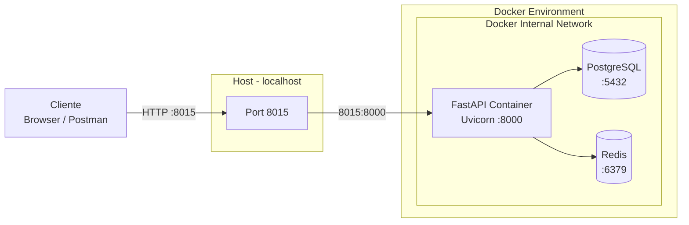
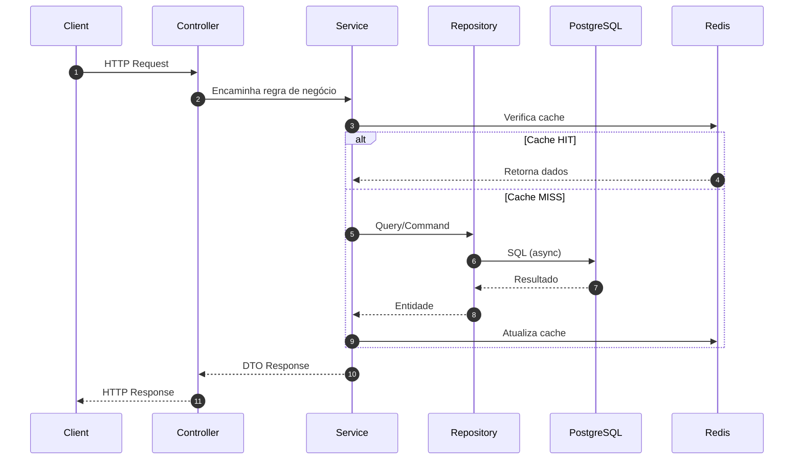

# 🐢 JABUTI – FastAPI Backend

Backend desenvolvido com **FastAPI**, gerenciado com **Poetry** e containerizado com **Docker Compose**.  
A aplicação segue arquitetura modular com separação clara de responsabilidades, preparada para ambientes escaláveis e produção.

---

## 🏗️ Arquitetura Geral (Host × Docker)

A aplicação é executada via Docker Compose, com separação entre:

- Cliente externo
- Host (localhost)
- Ambiente containerizado
- Rede interna Docker

### 🔌 Mapeamento de Portas

- Host → `8015`
- FastAPI (container) → `8000`
- PostgreSQL → `5432`
- Redis → `6379`



---

## 🔄 Fluxo Interno da Aplicação

A arquitetura segue o padrão Controller → Service → Repository/Model, com camada opcional de cache.



---

## 📐 Estrutura do Projeto

```text
JABUTI-FASTAPI/
│
├── migrations/
│   └── versions/                 # Arquivos de migração (Alembic)
│
├── src/
│   ├── main.py                   # Entry point da aplicação
│   │
│   ├── controllers/              # Camada de rotas
│   │   └── user_controller.py
│   │
│   ├── core/                     # Configurações e infraestrutura
│   │   ├── settings.py
│   │   ├── logging_config.py
│   │   ├── middlewares.py
│   │   └── request_context.py
│   │
│   ├── models/                   # Modelos ORM e conexão com banco
│   │   ├── database.py
│   │   └── user_model.py
│   │
│   ├── schemas/                  # Schemas Pydantic
│   │   └── user_schema.py
│   │
│   └── cache/                    # Integração com Redis
│       └── redis_client.py
│
├── Dockerfile
├── docker-compose.yml
├── pyproject.toml
├── poetry.lock
└── .env.example
```

---

## 🚀 Stack Tecnológica

### Backend
- Python 3.14
- FastAPI
- Uvicorn

### Persistência
- PostgreSQL
- SQLAlchemy (async)
- Alembic

### Cache
- Redis

### Infraestrutura
- Docker
- Docker Compose

### Gerenciamento de Dependências
- Poetry
---

## 🐳 Execução com Docker (Recomendado)

```bash
docker compose build
docker compose up
```

Parar containers:

```bash
docker compose down
```

Aplicação disponível em:

```
http://localhost:8015
```

Documentação automática:

- Swagger UI → http://localhost:8015/docs  
- ReDoc → http://localhost:8015/redoc  

---

## ⚙️ Execução Local com Poetry (Opcional)

```bash
poetry install
uvicorn src.main:app --reload --port 8015
```

---

## 🔐 Configuração de Ambiente

Crie um arquivo `.env` baseado no modelo:

```bash
cp .env.example .env
```

Depois:

```bash
docker compose up --build
```

⚠️ O arquivo `.env` não deve ser versionado.

---

## 🏛️ Padrão Arquitetural

- Separação por camadas (Controller → Service → Repository)
- Organização modular
- Containerização
- Versionamento de banco com Alembic
- Integração com Redis para cache
- Estrutura preparada para evolução e escalabilidade

---

## 📦 Objetivo

Base profissional para backend com:

- Organização enterprise-ready
- Boas práticas de desenvolvimento
- Arquitetura preparada para crescimento

---

## 👤 Autor

**Rafael Tasinato**  
AI & Software Engineer
